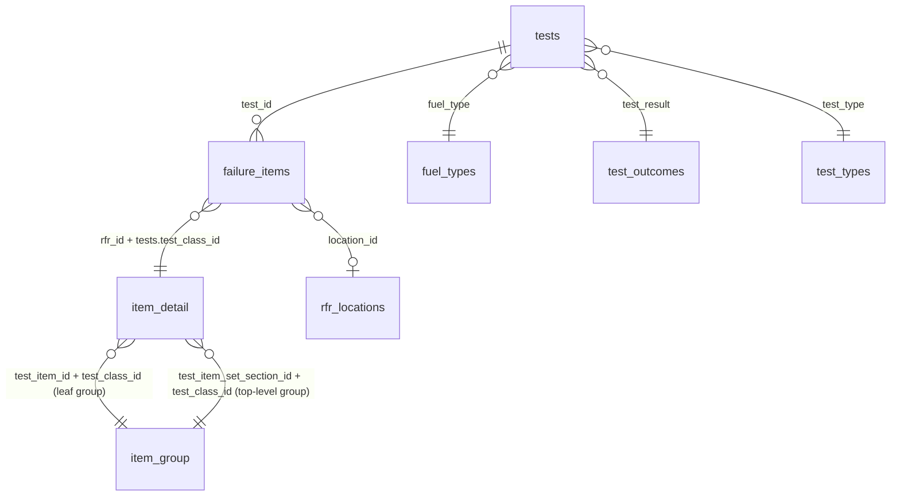

# mot-data-pipeline

[](https://github.com/jahadeesh/mot-data-pipeline/actions/workflows/ci.yml)

This pipeline turns the DVSA **Anonymised MOT tests and results** dataset (tens of millions of GB vehicle tests a year) into clean, documented, partitioned **parquet**. It downloads the files, extracts them, transforms them with DuckDB and validates the output.

It is the first of five connected repos. The later ones (a text-to-SQL agent, an MCP server and an eval toolkit) query the parquet produced here. That makes the [output schema](#output-schema) a contract, so changes to it are deliberate and documented.

## Quick start

Requirements: [uv](https://docs.astral.sh/uv/). uv installs Python 3.12 itself.

```bash
git clone <this repo> && cd mot-data-pipeline
uv sync
uv run mot-pipeline run --year 2024 --sample 100000
```

That run does the following:

1. Finds the 2024 download links from the dataset's data.gov.uk metadata.
2. Downloads three ZIPs: results (1.5 GB), failure items (0.7 GB) and lookups (0.25 MB). The download resumes if interrupted and is skipped next time.
3. Extracts January only. In sample mode only the first month is needed.
4. Writes 100,000 tests, their failure items and all lookup tables as parquet under `data/sample/parquet/`.
5. Prints a validation report, and exits non-zero if any check fails.

After the first download, a sample run takes about 15 seconds.

To process the full year, drop `--sample`. This extracts about 13 GB of CSV and writes to `data/parquet/`.

```bash
uv run mot-pipeline run --year 2024
```

Data goes to `./data` by default (git-ignored). To put it somewhere else, set `MOT_DATA_DIR` or pass `--data-dir`.

### Commands

| Command | What it does |
|---|---|
| `mot-pipeline download` | Downloads the ZIPs into `raw/`. Skips files that are up to date, resumes partial downloads, and records file name, URL, size, sha256, ETag and date in the committed [`manifest/downloads.json`](manifest/downloads.json). `--verify` re-hashes existing files. |
| `mot-pipeline extract` | Stream-extracts the CSVs into `extracted/`, skipping macOS junk. Idempotent. |
| `mot-pipeline transform` | Runs the DuckDB SQL in [`sql/`](sql/) and writes zstd parquet. |
| `mot-pipeline validate` | Runs the checks, prints the report, writes `reports/validation_<year>.json`, and exits 1 on any FAIL. |
| `mot-pipeline run` | All four in order. `--skip-download` works offline from existing ZIPs. |

Every command takes `--year` (default 2024), `--sample N` and `--data-dir`.

## Output

```
manifest/downloads.json            ← committed: exactly which source files built the data
data/
├── raw/            lookups/lookup.zip, 2024/{results,items}.zip
├── extracted/      CSVs (safe to delete after a transform)
├── parquet/                       ← full runs
│   ├── tests/test_year=2024/part_0.parquet ...
│   ├── failure_items/test_year=2024/part_0.parquet ...
│   └── lookups/{item_detail,item_group,rfr_locations,fuel_types,test_outcomes,test_types}.parquet
├── sample/parquet/                ← --sample runs (same layout, never mixed with full runs)
└── reports/        validation_<year>[_sample].json, transform_stats_<year>[_sample].json
```

Query it directly with DuckDB:

```sql
SELECT test_result, count(*) FROM 'data/parquet/tests/*/*.parquet' GROUP BY ALL;
```

## Output schema

All files are parquet with zstd compression. `tests` and `failure_items` are hive-partitioned by `test_year`, and each file also stores `test_year` itself as `SMALLINT`. Hive-aware readers re-infer the type from the directory name instead; DuckDB, for example, reads it as `BIGINT`.

### `tests`: one row per MOT test (primary key `test_id`)

| Column | Type | Description |
|---|---|---|
| `test_id` | BIGINT | Unique test identifier |
| `vehicle_id` | BIGINT | Anonymised vehicle identifier, stable across tests and years (derived from registration and VIN) |
| `test_date` | DATE | Date of test |
| `test_class_id` | VARCHAR | Vehicle test class: `1`/`2` motorcycles, `3` three-wheelers, `4` cars and light vans, `5` large passenger vehicles, `7` goods vehicles 3,000–3,500 kg |
| `test_type` | VARCHAR | `NT` normal test, `RT` retest, `PL`/`PV` partial retests, `ES`/`EI` appeals. See `lookups/test_types` |
| `test_result` | VARCHAR | `P` pass, `F` fail, `PRS` pass after rectification at station, `ABA` abandoned, `ABR` aborted, … See `lookups/test_outcomes` |
| `test_mileage` | INTEGER | Odometer reading in miles. NULL when no reading was taken (the source has 0 or blank) |
| `postcode_area` | VARCHAR | Postcode area of the test station (e.g. `BS`). `XX` = areas with fewer than 5 sites, merged |
| `make` | VARCHAR | Vehicle make (`UNCLASSIFIED` if unknown) |
| `model` | VARCHAR | Vehicle model |
| `colour` | VARCHAR | Vehicle colour as recorded at test |
| `fuel_type` | VARCHAR | 2-letter fuel code (`PE`, `DI`, `HY`, `EL`, …). See `lookups/fuel_types` |
| `cylinder_capacity` | INTEGER | Engine size in cc (NULL if missing) |
| `first_use_date` | DATE | Date of first use. `1971-01-01` is the DVLA placeholder for unknown dates |
| `completed_at` | TIMESTAMP | When the test was completed, in UTC |
| `test_year` | SMALLINT | Release year; partition key |

### `failure_items`: defects recorded against a test (foreign key `test_id` → `tests`)

| Column | Type | Description |
|---|---|---|
| `test_id` | BIGINT | The test this item belongs to |
| `rfr_id` | INTEGER | Reason-for-rejection id. Join to `item_detail` on `(rfr_id, tests.test_class_id)` |
| `rfr_type_code` | VARCHAR | `F` fail, `P` PRS (repaired within the hour), `A` advisory, `M` minor defect |
| `location_id` | INTEGER | Where on the vehicle. Join to `rfr_locations` |
| `is_dangerous` | BOOLEAN | Tester marked the defect dangerous |
| `completed_at` | TIMESTAMP | Completion time of the test, in UTC |
| `test_year` | SMALLINT | Release year; partition key |

There is no item-level primary key, because one test can legitimately record the same RfR at several locations.

### Lookups (`lookups/<name>.parquet`)

| Table | Key | Columns |
|---|---|---|
| `item_detail` | `(rfr_id, test_class_id)` | `test_item_id`, `minor_item` BOOL, `rfr_deficiency_category` (`Dangerous`/`Major`/`Minor`/`Pre-EU Directive`), `rfr_desc`, `rfr_loc_marker` BOOL, `rfr_insp_manual_desc`, `rfr_advisory_text`, `test_item_set_section_id` |
| `item_group` | `(test_item_id, test_class_id)` | `parent_id`, `test_item_set_section_id`, `item_name`. A hierarchy whose root (`test_item_id` 0) is "Vehicle" |
| `rfr_locations` | `location_id` | `lateral`, `longitudinal`, `vertical` |
| `fuel_types` | `fuel_type_code` | `fuel_type` |
| `test_outcomes` | `test_result_code` | `test_result` |
| `test_types` | `test_type_code` | `test_type` |

### How the tables join



Example: the most common top-level defect areas for failed car tests.

```sql
SELECT g.item_name, count(*) AS defects, count(DISTINCT t.test_id) AS tests
FROM 'data/parquet/tests/*/*.parquet'          AS t
JOIN 'data/parquet/failure_items/*/*.parquet'  AS i USING (test_id)
JOIN 'data/parquet/lookups/item_detail.parquet' AS d
  ON d.rfr_id = i.rfr_id AND d.test_class_id = t.test_class_id
JOIN 'data/parquet/lookups/item_group.parquet'  AS g
  ON g.test_item_id = d.test_item_set_section_id AND g.test_class_id = d.test_class_id
WHERE t.test_class_id = '4' AND t.test_type = 'NT' AND t.test_result IN ('F', 'PRS')
  AND i.rfr_type_code IN ('F', 'P')
GROUP BY ALL ORDER BY defects DESC;
```

## Validation

`validate` reads the **written parquet**, not the staging tables, so it checks what consumers will actually see.

| Check | Fails the run when |
|---|---|
| Row counts | Any table is empty, or a sample doesn't have exactly N tests |
| Key columns | Any null in `tests.test_id/test_date/test_result/test_class_id`, `failure_items.test_id/rfr_id/rfr_type_code`, or a lookup key; any duplicate `test_id` or lookup key |
| Dates | Any `test_date` or item `completed_at` outside the requested year |
| Failure items → tests | Fewer than 99% of failure items join to a test |
| Unparseable CSV rows | More than 0.1% of rows rejected (a WARN for any non-zero count) |

These are warnings only: failed tests with no `F` item (below 95%), and failure items that don't join to `item_detail` (below 99%). INFO lines report duplicates dropped, repeated CSV headers and any unrecognised fuel values. Thresholds live in [`config.py`](src/mot_pipeline/config.py).

## Data quality notes

These come from the 2024 files, using January as measured by the sample run.

- **Duplicated rows.** 6,140,788 result rows hold only 3,848,449 distinct rows (37% exact duplicates).
- **Conflicting rows.** 64,159 test_ids (1.7%) have *conflicting* rows, e.g. different `colour` or `first_use_date`.
- **Duplicated failure items.** About 20% of failure-item rows are exact duplicates.
- **The user guide (v5.1) describes an older layout.** The 2024 files are comma-separated, not pipe-separated, with ISO dates and an extra `completed_date` column. The failure-item columns are renamed (`rfr_type_code`, `mot_test_rfr_location_type_id`, `dangerous_mark`).
- **Repeated headers.** Each monthly CSV repeats its header line 15 times mid-file.
- **Backslash escapes.** Quotes inside values are escaped with a backslash (`"STREETZONE 50 2T 12\""`).
- **Mixed fuel values.** `fuel_type` mixes codes (`EL`) with descriptions (`Electric`, `Hybrid Electric (Clean)`).
- **Mileage.** `test_mileage` arrives as a float string (`65494.0`).

## Design decisions

Every non-obvious decision is recorded in **[docs/DECISIONS.md](docs/DECISIONS.md)**, with the alternatives considered and the reasons. The main ones:

- **Download links are discovered, never hard-coded,** from the dataset's data.gov.uk metadata ([D-001](docs/DECISIONS.md#d-001-discover-download-urls-from-ckan-metadata)).
- **Only post-May-2018 data is in scope,** because the defect categories changed then ([D-002](docs/DECISIONS.md#d-002-scope-post-may-2018-data-only)).
- **Where the real files disagree with the user guide, the files win,** and each difference is documented ([D-003](docs/DECISIONS.md#d-003-the-user-guide-is-the-reference-but-the-real-files-win)).
- **`tests` has exactly one row per `test_id`,** chosen by a fixed rule ([D-007](docs/DECISIONS.md#d-007-keep-exactly-one-row-per-test_id)). **Failure items lose exact duplicates only** ([D-008](docs/DECISIONS.md#d-008-failure-items-drop-exact-duplicates-only)).
- **Malformed CSV rows are counted rather than fatal** ([D-009](docs/DECISIONS.md#d-009-count-malformed-csv-rows-dont-crash)).
- **`test_year` is the release year,** so re-running a year replaces only that year's folder ([D-011](docs/DECISIONS.md#d-011-test_year-is-the-release-year)).
- **Sample mode reads one month and keeps its joins complete** ([D-012](docs/DECISIONS.md#d-012-sample-mode-design)).
- **Downloads resume safely,** and every input is recorded in a committed manifest ([D-013](docs/DECISIONS.md#d-013-resumable-downloads-keyed-on-etag), [D-014](docs/DECISIONS.md#d-014-commit-the-download-manifest)).

## Architecture

> _Architecture diagram placeholder. A diagram of download → extract → transform → validate, and how the downstream repos consume the parquet, will go here._

## Development

```bash
uv sync                          # install, including dev tools
uv run pytest                    # tests (synthetic fixtures only, no network)
uv run ruff check . && uv run ruff format .
uv run pre-commit install        # ruff and hygiene hooks on every commit
```

Tests never use real DVSA data. [`tests/fixtures`](tests/fixtures) holds small synthetic CSVs that reproduce every quirk listed above, and an autouse fixture blocks network access. CI ([`.github/workflows/ci.yml`](.github/workflows/ci.yml)) runs lint, format check and tests on every push and pull request.

### Not built yet (planned)

The design leaves room for these, but they aren't built:

- Publishing to Hugging Face.
- Scheduled refresh workflows.
- Years other than 2024. These should mostly work already via `--year`, but haven't been tested.

## Licence

- **Code:** MIT, see [LICENSE](LICENSE).
- **Data:** the MOT data is published by the [Driver and Vehicle Standards Agency](https://www.data.gov.uk/dataset/c63fca52-ae4c-4b75-bab5-8b4735e1a4c9/anonymised-mot-tests-and-results) under the [Open Government Licence v3.0](https://www.nationalarchives.gov.uk/doc/open-government-licence/version/3/). Contains public sector information licensed under the Open Government Licence v3.0. This repository contains no DVSA data; the pipeline downloads it from the source. Derived parquet you publish must carry the same attribution.
